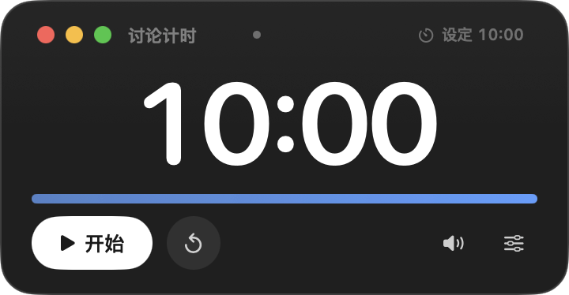
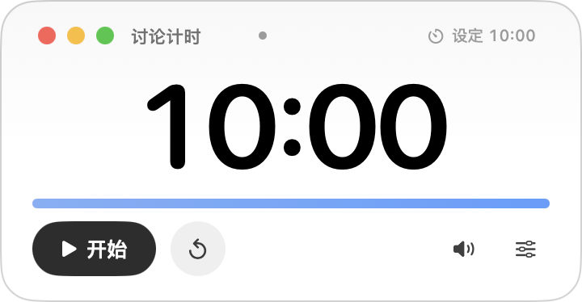
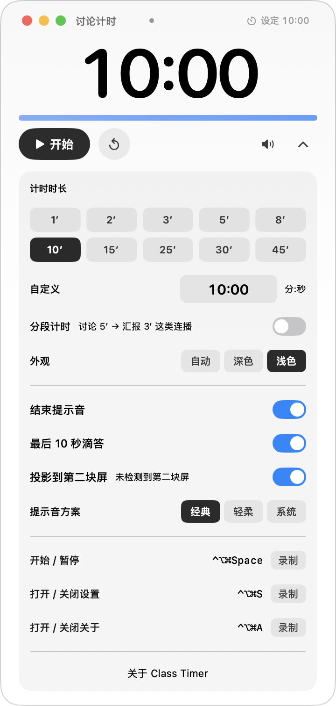
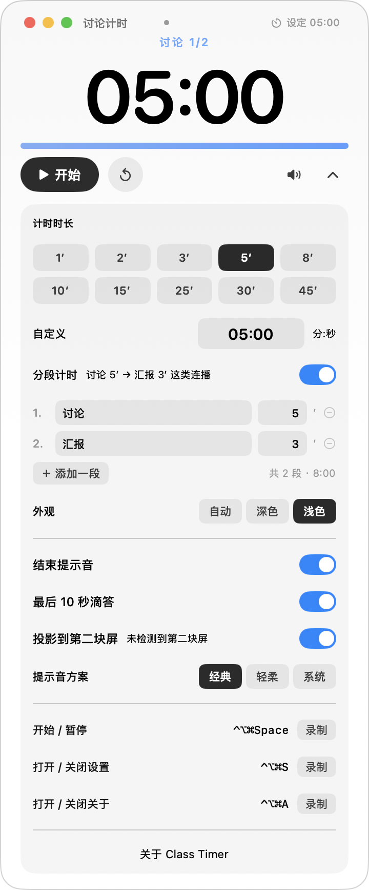
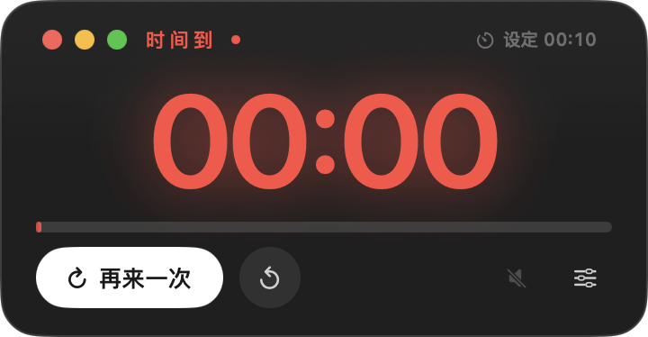

# ClassTimer（课堂计时器）

> **为什么要再写一个计时器？**
> 目前几乎所有计时器类 App 都有同一个毛病：**Keynote 或 PowerPoint 一进入全屏放映，
> 浮窗就会被放映画面盖住**——讲师看不到剩余时间，只能切出去看，或者干脆放弃计时。
> ClassTimer 专门解决这一点：它用 `.screenSaver` 窗口层级和全屏辅助窗口行为，
> 在 Keynote、PowerPoint 放映时**依然浮在幻灯片之上**，而且不抢键盘焦点
> （放映中按空格翻页照常工作）。

培训课堂上做分组讨论时的浮层倒计时工具。英文名 **Class Timer**，口号：**累了就休息一下吧**。它始终浮在所有窗口之上，包括 Keynote 全屏放映的幻灯片；点它不会打断放映、也不会抢走翻页用的键盘焦点。



## 使用方式

1. 双击 `ClassTimer.app`（已安装到 `~/Applications`）。
2. 点击「开始」倒计时；再点一次「暂停」，暂停后按钮变「继续」。
3. 点右下角齿轮（或顶部的「设定 10:00」）展开时长设置：
   - 预设：1′ 3′ 5′ 10′ 15′ 20′ 30′ 45′
   - 自定义：直接输入 mm:ss 或分钟数（`0012` → 00:12），范围 10 秒 ~ 99 分 59 秒
   - 开关：结束提示音、最后 10 秒滴答、投影到第二块屏
   - **自定义时长**：每次点输入框都会清空旧值，直接输新数字；输 `0012` 回车自动变成 `00:12`
     （1–2 位按分钟，如 `25` → 25:00；回车后自动退出编辑）
   - **分段计时**：打开后可编辑「讨论 5′ → 汇报 3′」这类连播，段末自动接下一段；
     只有最后一段结束才响佛铃
   - **提示音方案**：经典（木鱼/佛铃+台词）/ 轻柔（合成滴答+柔和钟声）/ 系统
   - **外观**：自动（按背景亮度反色）/ 深色 / 浅色
4. **最后 10 秒**：每秒一声木鱼提示音，提醒讨论要收尾；**剩最后 1 秒时起佛铃「チーン」**，铃的尾音自然收掉后接童声「休息！休息一会儿！」（两者不重叠），同时浮窗红色闪烁、大字变红。两项声音可在设置里分别关。
5. **投影到第二块屏**：打开开关后，第二块屏（投影）上出现一个大号只读计时板，跟着主屏同步倒数；投影板上没有按钮，误点也不会改计时状态。只有一块屏时开关自动置灰。
6. 拖动浮窗任意空白处可移动位置，位置会自动记住。
7. 菜单栏常驻一个 `⏱ 剩余时间` 图标，点开可以：显示/隐藏计时器、把计时器放回右上角、开始/暂停、重置、退出。

## 关键特性

- **浮在全屏放映之上**：窗口层级取 `NSWindow.Level.screenSaver`，并声明 `canJoinAllSpaces + fullScreenAuxiliary + stationary`，进入 Keynote 放映的全屏空间后依然可见；切换 Space、插拔显示器时会自动重新置顶，跑出屏幕则自动拉回主屏。
- **不打断放映、不抢键盘**：窗口是 `nonactivatingPanel` 且 `canBecomeKey = false`，点击只作用于计时器本身，Keynote 保持放映状态，讲师用空格翻页也不受影响。
- **一眼可读**：深色卡片 + 72pt 等宽数字，投影后远距离也清楚；进度条随剩余时间由蓝转橙再转红。
- **双屏分工**：讲师笔记本屏幕上是有按钮的控制台，投影屏上是 178pt 的只读大数字，学员远看也能读清；两块屏共用同一个计时模型，点击后即时同步。
- **计时准确**：基于截止时刻计算而不是累加 tick，主线程偶尔卡顿（拖窗口、切空间）不会累积误差。
- **面板高度自适应**：设置/关于面板展开时窗口随内容长高（不再写死 190/690/520），
  长高出屏幕时自动上移回可见区。
- **隐藏后能找回**：URL scheme `open "classtimer://show"`（或 `classtimer://toggle`）、
  菜单栏「显示浮窗」、`open -a ClassTimer` 三条路都能把浮窗叫回来。
- **每次启动在右上角**：浮窗固定放在屏幕右上角（距边 12pt），不恢复上次拖到的位置；
  讲课前后位置一致，不用每次找。窗口关闭了系统状态恢复，启动时始终是紧凑高度，
  不会莫名其妙展开设置面板。

## 界面

| 紧凑态（深色） | 紧凑态（浅色） |
|---|---|
|  |  |

设置面板（浅色）：



分段计时（讨论 → 汇报连播）：



到点提醒：



## 从源码构建

```bash
cd ClassTimer
./build.sh                    # 构建并安装到 ~/Applications（默认就安装）
./build.sh --no-install       # 只构建，不安装
./build.sh --bump             # 先把 VERSION 递增一个版本号再构建
./build.sh --dry-run          # 只打印版本与输出路径，不编译
```

构建脚本自动查找本机 Apple Development 证书签名；机器上没有证书时回退 ad-hoc——但 ad-hoc 签名每次构建都变，TCC 会认不出同一个 app，屏幕录制权限需要反复授权。

版本号唯一来源是本目录的 `VERSION`（x.y.z，每一位 0-9，逐次进位）；构建号 `CFBundleVersion` 取构建时刻的 `YYYYMMDDhhmmss`。

## 自动化验证用的启动参数

```bash
./build/ClassTimer.app/Contents/MacOS/ClassTimer \
  --seconds 30 \        # 设定时长（秒）
  --autostart \         # 启动即开始计时
  --open-settings \     # 启动即展开时长设置
  --request-screen-capture \  # 向系统请求一次屏幕录制权限（登记进系统设置列表）
  --verbose             # 把操作与窗口坐标打到 stderr，便于排查
```

## 目录结构

```
ClassTimer/
├── VERSION                     版本号唯一来源
├── build.sh                    编译 + 打包 .app + 签名（Apple Development，缺证书回退 ad-hoc）
├── Sources/（10 个文件，全部纯代码，无 xib）
│   ├── main.swift              App 入口（accessory：无 Dock 图标）
│   ├── TimerModel.swift        计时状态机、滴答/结束提醒、持久化
│   ├── TimerPanel.swift        浮窗与投影板、层级/空间策略、菜单栏
│   ├── TimerView.swift         主屏控制界面
│   ├── SettingsView.swift      时长/开关设置面板（内嵌主窗）
│   ├── AboutPanel.swift        关于面板（内嵌主窗）
│   ├── Palette.swift           深/浅两套配色
│   ├── AppearanceSampler.swift 背景亮度采样（ScreenCaptureKit）
│   ├── HotKey.swift            全局热键（Carbon）
│   └── ProjectionView.swift    第二块屏的只读大数字板
├── Resources/                  提示音 wav（不入 git，见「已知边界」）
├── scripts/
│   ├── make_sounds.sh          从原版动画片段重新生成经典提示音
│   ├── make_soft_sounds.sh     纯合成「轻柔」提示音（ffmpeg lavfi，不依赖外部素材）
│   └── make_icon.py            生成 App 图标（黑色渐变底 + 细线 + 衬线 C）
├── assets/
│   ├── AppIcon.iconset/        各尺寸图标（入 git）
│   ├── AppIcon.icns            构建时拷进 .app；.gitignore 白名单未收 *.icns，
│   │                           需 `git add -f`；缺失时 build.sh 用 iconset 重建
│   └── screenshot-*.png        界面截图（紧凑深/浅、设置、分段、到点、投影）
└── dist/                       打包产物（dmg）
```

## 打包分发

```bash
cd ClassTimer
./build.sh                    # 构建并安装到 ~/Applications（默认就安装）

# 打一个可以拖拽安装的 dmg
mkdir -p /tmp/dmg_src && cp -R "build/ClassTimer.app" /tmp/dmg_src/
ln -s /Applications /tmp/dmg_src/Applications
hdiutil create -volname "ClassTimer" -srcfolder /tmp/dmg_src \
  -ov -format UDZO "dist/ClassTimer-$(cat VERSION).dmg"
```

图标由 `scripts/make_icon.py` 生成，版式参照 Markable：黑色斜向渐变圆角方块 + 左侧半透明细竖线 + 白色衬线体 C（Bodoni 72 Bold），追求优雅感而不是科技感。

「关于」窗口（菜单栏 → 关于 Class Timer）显示图标、英文名、`版本 x.y.z (构建号)`、口号与版权，版式与 Markable 一致。

## 已知边界

- 只支持 macOS 14 及以上（当前实现在 macOS 27 上验证）。
- 多显示器环境下默认放在带菜单栏的主屏；如果拖到别的屏，放映发生在另一块屏时，需要把计时器再拖到放映屏上。
- **提示音做过温和化处理**（木鱼低通 3kHz、铃 4kHz、台词 5.5kHz，高频搁架再压 2–4dB），避免投影音响上发尖刺耳。结构为「最后 10 秒每秒一声木鱼 → 最后一秒起佛铃 → 铃尾音结束后台词」，结束音效 4.45 秒。
- 生成流程见 `scripts/make_sounds.sh`（ffmpeg 一行行记录，可重现）：`./scripts/make_sounds.sh /tmp/ikkyu_ep.wav /tmp/ikkyu.wav`。
- 音量跟随系统输出音量；设置里的两个开关可以分别关掉滴答和结束提示音。
- 自动配色依赖「屏幕录制」权限；已授权时设置面板里不显示权限行，未授权才提示。
  若「系统设置 → 隐私与安全性 → 录屏与系统录音」里没有 ClassTimer，
  运行 `ClassTimer --request-screen-capture` 登记一次即可。
- 投影板固定放在「主屏之外的第一块屏」；如果接了多块外接屏，目前只镜像到其中一块。
- 「最后 10 秒」的滴答按整秒触发：10、9、……、1 各一声，共 10 声。

## License

[MIT](LICENSE) © 钟义杰
